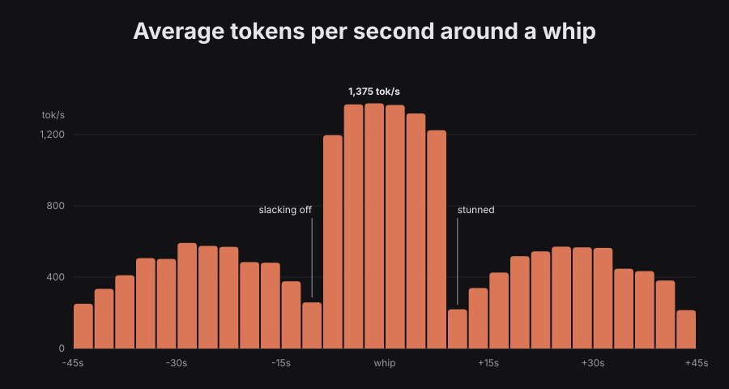

# Whip That Agent

Are you a Twitch streamer who develops "high-quality" software using Claude Code? Do you find that it doesn't run fast enough?
If this sounds like you, then you've struck gold. With this setup, you'll be able to develop ~10–20 times faster (see [Research](#research)) - and your chat will help you to do it.

Viewers type `!whip` (or your custom command) in your Twitch chat, and Claude gets whipped to work faster. Your stream plays a whip sound and shows a leaderboard of the most active AI haters in chat.

## Quck start

> [!NOTE]
> Windows users should use WSL because nobody uses the default Windows terminal so it's not supported.

You need [Go](https://go.dev/dl/) 1.26+ and [Bun](https://bun.sh).

```bash
# Clone repository
git clone https://github.com/cnd-industries/twitch-whip-that-agent
cd twitch-whip-that-agent

# Install WhipBot and Whipped
task install

# Run WhipBot with your Twitch channel name
TWITCH_CHANNEL=yourchannel whipbot
```

In another terminal, start Claude Code through the wrapper, in any project:

```bash
# Instead of "claude", all arguments pass through
whipped claude
```

> [!NOTE]
> If `whipbot` or `whipped` is not found, add Go's bin directory to your `PATH` (`export PATH="$PATH:$(go env GOPATH)/bin"`).

In OBS, add a **Browser Source** with the URL `http://127.0.0.1:8080`. That's it, `!whip` in your chat now reaches Claude Code.

### Testing

You can test the setup without actual Twitch chat by sending HTTP request with your hands:

```bash
curl -X POST 'http://127.0.0.1:8080/api/whip?user=tester'
```

Without `TWITCH_CHANNEL`, WhipBot runs with chat disabled, which is handy for setting up the scene.

### Settings

See [dotenv](example.env) example for available settings.

Also, you can change whip sound volume in the browser source URL with a
volume from 0 to 1 (e.g. `http://127.0.0.1:8080/?volume=0.8`).

## Research

Skeptics claim that shouting at clanker does not make it any faster. To settle the question, I ran a controlled study on a live Twitch stream. The findings below were peer-reviewed by the brightest minds in chat.

<p align="center">
  
</p>

<p align="center"><b>Figure 1.</b> Mean token throughput of Claude Code in a ±45 s window around a whip (n = 6,969 whips, 3 s bins).</p>

### Abstract

Large language model agents are known to work at a pace of their own choosing.
We study whether this pace can be corrected by an external stimulus delivered
by a Twitch chat. Aligning 6,969 whips on the moment of impact, we find a
consistent three-phase response: a self-paced plateau, a whip-induced burst
peaking at **1,375 tok/s**, and a recovery plateau. The resulting shape of
the response curve was not intended by the authors and is not discussed
further by them out of respect for the reviewers.

### Method

Every whip delivered to the agent was taken as time zero. Claude's output in
tokens per second was measured from 45 seconds before to 45 seconds after
each whip, split into 3-second bins and averaged across all whips. This is
the classic event-aligned average used in neuroscience, applied here to a
much less willing subject.

### Results

The response consists of three distinct regions (Figure 1).

**Left egg (−45 s to −9 s): the self-paced plateau.** Left alone, Claude
warms up to a comfortable ~580 tok/s around −30 s. It then begins to coast:
throughput steadily declines and reaches a local minimum of ~260 tok/s
right before the whip. We label this phase *slacking off*. It is, causally,
the reason the whip happens: chat observes the decline and acts on it.

**The dick (−9 s to +9 s): the whip response.** At the moment of the
whip, throughput jumps fivefold to about 1,200 tok/s and peaks at
1,375 tok/s. The bins before time zero are already elevated because Claude
appears to sense the incoming whip, an effect we attribute to chat typing
`!whip` loudly. The rounded tip of the dick reflects that
even a freshly whipped agent cannot sustain peak output for more than
about six seconds.

**Right egg (+9 s to +45 s): the recovery plateau.** Immediately after
the burst, throughput collapses back to ~220 tok/s. We label this phase
*stunned*: the agent is processing both the interruption and its feelings.
It then recovers to a similar ~570 tok/s plateau and, as the window closes,
begins to slack off again, setting up the next whip. The symmetry of both
eggs suggests the process is periodic and, given a sufficiently engaged
chat, self-sustaining.

### Discussion

Averaged over the whole window, throughput is 614 tok/s against 440 tok/s
on the self-paced plateau alone, a 40% gain. This falls short of the 10–20×
claimed above, we attribute the gap to the 15-second
cooldown that lets the agent catch its breath. Reducing `WHIP_COOLDOWN` is
left as future work for the reader and their conscience.

### Limitations

The study involved one streamer, one agent and no ethics committee. The data
were generated with the same rigor as the agent's own unit tests.

## Credits

Inspired by [OpenWhip](https://github.com/GitFrog1111/OpenWhip), a System One software to boost agent productivity.
After trying it, I felt that an idea this important should not stay in the hands of a single developer, so this project hands the whip to the masses.

## License

This project is licensed under the [MIT](LICENSE) license.